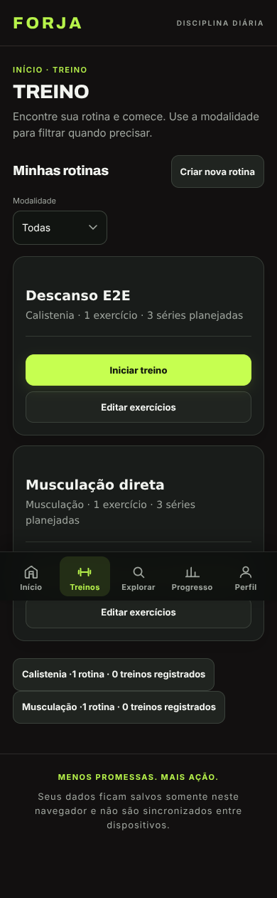
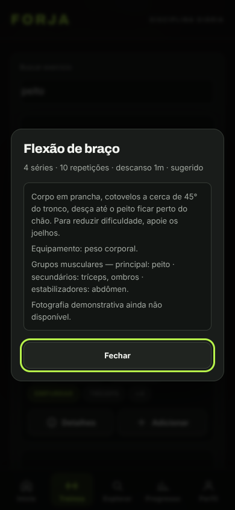
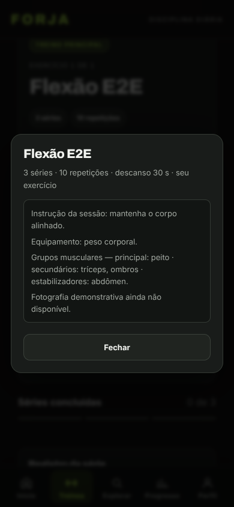

# FORJA — primeira evolução web

## Escopo e base

Base conferida com `git fetch origin main`: `1b66b96f5c60c234646aa98c7b8f12ef37295a49`,
idêntica ao HEAD inicial da branch `arena/06cb7da5-forja`. Não houve troca de branch.

Entrega limitada a acesso direto às rotinas, catálogo contextual, instruções na
execução e foco. Sem nova identidade, aba, dependência, backend, smartwatch,
sistema de métricas, mudança de armazenamento, cache ou service worker.

## Decisões e arquivos

| Arquivos | Decisão |
| --- | --- |
| `treino/index.html`, `assets/js/forja-treino.js` | Rotinas primeiro, filtro Todas/Calistenia/Musculação e Iniciar/Editar diretamente. Reutiliza `renderRoutineCard` em modo compacto e `F.startRoutine`; ações de gestão e histórico permanecem nas páginas de modalidade, acessíveis por links secundários. |
| `assets/js/forja-treino.js`, `assets/js/forja-catalogo.js`, `treino/rotina.html` | Editor consome `catalog.filter`, a mesma linha `catalog.renderRow` e o mesmo detalhe da biblioteca. Busca também músculos/equipamentos; mantém inclusão no rascunho e salvar explícito. Exercícios já adicionados também têm Detalhes. |
| `assets/js/forja-catalogo.js` | Consulta somente-leitura omite destino de inclusão, histórico e figura anatômica; mostra instruções, equipamento, músculos e notas. Completa somente por ID exato e não altera snapshots ou registros. Biblioteca completa mantém seu fluxo de inclusão e atlas já existente. |
| `treino/executar.html`, `assets/js/forja-sessao.js` | “Como executar” chama o mesmo detalhe, sem pausar, salvar ou remontar a execução. O descanso continua pelo timestamp original. |
| `assets/js/forja-core.js` | Corrige foco inicial dos modais com somente ação de cancelamento/Fechar. Reaproveita Escape, confinamento de Tab e retorno ao acionador existentes. |
| `assets/css/marca.css` | Ajustes locais de espaçamento, quebra de linha e toque, preservando tokens, fundos e verde-lima. Sem reorganização da barra inferior. |
| `tests/forja.test.mjs`, `tests/e2e.browser.mjs` | Regressões novas e atualização de duas asserções que exigiam os antigos cartões de modalidade (agora links secundários). Nenhum teste de proteção foi removido. |
| `docs/fotografias-exercicios.md` | Contrato de identidade, licença, autoria e revisão. Manifesto vazio; piloto de até oito exercícios apenas proposto, não publicado. |

Não há novo catálogo paralelo, gravação ao consultar, nova chave de armazenamento
ou alteração de backup. Envelope de backup continua v1 e modelo de dados v3;
a suíte existente cobre as gerações v1/v2/v3 e os mecanismos de recuperação.

## Regressões acrescentadas

- 78: lista e filtro sem escrita, rotina vazia não iniciável, edição/início da
  modalidade correta diretamente no hub.
- 79: campos ainda digitados, nome em rascunho, ordem e IDs intactos ao consultar;
  Escape, foco, catálogo compartilhado e inclusão sem gravar antes de Salvar.
- 80: sessão, campos, descanso e armazenamento idênticos antes/depois da consulta;
  tempo continua, pausa é preservada, reload recupera dados.
- 81: identidade explícita, preenchimento por origem exata, ausência de associação
  por nome e manifesto de fotos vazio/congelado.
- Três verificações E2E correspondentes em Chromium real, incluindo Tab/Shift+Tab,
  Escape, foco, valores persistidos e rotinas populadas a 320/390/1280 px.

## Verificação final

Estado final do código validado em 25/10/2026:

| Comando | Resultado real |
| --- | --- |
| `npm test` | **177/177**: MÉTRICAS 18, FORJA 107, ATLAS 12, PARIDADE 40 |
| `LD_LIBRARY_PATH=/tmp/al2023/lib npm run test:e2e` | **32/32** verificações em Chromium real |
| `git diff --check` | Sem erros de whitespace |
| Comparação binária com a main de base | **12/12 arquivos protegidos idênticos** |

O E2E cobre todas as páginas em 320, 360, 390, 430, 768 e 1280 px e os novos
fluxos populados também em 320/390/1280 px. Nenhum erro JavaScript foi capturado.
Permanecem os testes 77a–77k para os 11 defeitos corrigidos, paridade de dados,
backups, importação com falha/desfazer, rotação e recuperação de sessão.

O primeiro lançamento do Chromium falhou por ausência de `libnspr4.so` no
sandbox. Foram extraídas as bibliotecas já empacotadas em
`node_modules/@sparticuz/chromium/bin/al2023.tar.br` para `/tmp/al2023`, sem
adicionar dependências ou modificar o projeto. Rodar o E2E neste ambiente exige
`LD_LIBRARY_PATH=/tmp/al2023/lib`. Um novo teste inicialmente esperava navegar
após Salvar, mas o contrato existente mantém o editor aberto: a asserção foi
corrigida para verificar esse comportamento real. As duas suítes completas
passaram no código final, inclusive após remover o fallback de conversão paralelo.

### Evidências dos fluxos (dados sintéticos de teste)

1. **Rotinas diretas:** lista de ambas as modalidades; filtro e início direto
   verificados em navegador, sem escrita ao filtrar.

   

2. **Editor:** busca por músculo, detalhes no próprio contexto e foco em Fechar;
   Escape retorna ao acionador. Testes comparam nome, campos ainda digitados,
   ordem, IDs e storage antes/depois, e verificam inclusão/salvamento.

   

3. **Execução:** instrução da cópia da sessão, equipamento e grupos disponíveis;
   abrir/fechar não escreve nem redefine o descanso. Teste também pausa,
   recarrega e retoma preservando as repetições digitadas.

   

## Limites e observações

- Chromium automatizado não equivale a validação manual em Safari, Firefox,
  VoiceOver, TalkBack ou NVDA. Não houve teste com usuários nem sensores físicos.
- Não há fotografias aprovadas/publicadas; o fallback é textual e não requer rede.
- Sessão e descanso continuam normalmente enquanto as instruções estão abertas;
  não foi introduzida uma pausa implícita.
- O editor mantém a guarda de saída existente. Biblioteca completa continua sendo
  uma navegação externa opcional, identificada como “fora do editor”.
- `npm ci` instalou apenas as dependências do lockfile existente. `npm audit`
  apontou nove avisos high na árvore de desenvolvimento do Puppeteer; a correção
  sugerida envolve upgrade major. Não se aplicou `audit fix --force`, nem houve
  mudança de lockfile. Essas dependências não são carregadas pelo aplicativo
  estático no navegador; o tratamento é uma tarefa separada, não uma correção
  de segurança supostamente entregue aqui.

> **Nota de escopo posterior (2026-10-27).** Este documento descreve a primeira
> evolução web. A frase “não há fotografias aprovadas/publicadas” continua
> verdadeira para **fotos**. Uma entrega posterior adicionou **ilustrações** do
> catálogo livre RepDB (contrato separado, sem fotos, sem nova chave de
> armazenamento, sem service worker). Ver `docs/demonstracoes-revisao.md`,
> `docs/creditos-repdb.md` e `docs/fotografias-exercicios.md`.
