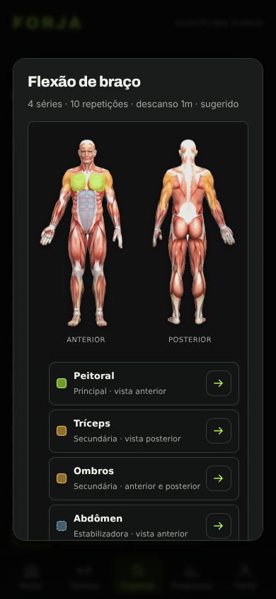

# Etapa 2 — infraestrutura validável; publicação bloqueada

## Diagnóstico e decisão (2026-10-25)

Lidos `fotografias-exercicios.md` e `evolucao-web-etapa1.md`; inspecionados
`forja-catalogo.js`, `forja-treino.js` e `forja-sessao.js`. Catálogo e editor
compartilham linhas; biblioteca, edição e execução compartilham detalhes.
A origem é `mode + ':' + (libraryId || id)`. Nenhuma associação por nome,
migração, escrita ao consultar ou alteração de snapshots foi introduzida.

**Imagens incluídas: nenhuma.** Não há fonte/licença individual aprovada.
O manifesto permanece vazio/congelado, sem rascunhos distribuídos. Esta entrega
não deve ser descrita como piloto de fotografias publicado ou concluído.

## Pesquisa e pendências

Acesso de rede neste ambiente restrito a GitHub e registros de pacotes; não foi
possível fazer pesquisa direta no Wikimedia Commons nem na API pública wger.
Foram consultados via GitHub API:

- https://github.com/yuhonas/free-exercise-db/blob/main/README.md
- https://github.com/yuhonas/free-exercise-db/blob/main/LICENSE.md
  O conjunto declara Unlicense, mas o README remete à importação de
  `wrkout/exercises.json`. Isso não comprova por fotografia a autoria,
  cadeia de autorização ou permissão das pessoas retratadas exigidas no contrato.
  Nenhuma mídia foi copiada/aprovada com base apenas nessa declaração.
- https://github.com/wger-project/wger/blob/master/LICENSE.txt
  AGPL-3.0 de software não autoriza automaticamente as fotografias.
- https://github.com/wger-project/wger/blob/master/wger/exercises/fixtures/test-exercise-images.json
  Dados explicitamente de teste (inclusive arquivos de javalis), não evidência
  de correspondência nem permissão para exercícios do FORJA.

Seleção provisória reduzida: `cal-flexao`, `cal-agachamento`,
`cal-prancha-frontal`, `mus-supino-reto`. Todos **sem foto**: falta obter
arquivo original, fonte individual, licença aplicável, autoria disponível,
permissão de imagem/justificativa e revisão técnica da variante. Não se afirma
frequência estatística. As outras origens propostas na etapa 1 não foram ampliadas.
Nenhuma imagem genérica, comercial, anatômica ou gerada por IA substitui a foto.

## Código preparado, sem ativar mídia não aprovada

- Seleção exige origem sugerida real, modo/ID exatos, status aprovado, campos
  obrigatórios, fonte/licença HTTPS, arquivo local e dimensões explícitas.
- Cópias com nome, instrução ou equipamento divergente ficam sem foto. É uma
  política conservadora: até uma renomeação cosmética pode ocultar a imagem.
  Não é uma revisão biomecânica automática nem prova legal de uma aprovação.
- Renderização compartilhada em catálogo/editor e detalhes/consulta da execução;
  só ocorre com aprovação. Sem fotos, não há requisições de mídia nem espaços
  vazios nas linhas. O texto existente permanece no detalhe.
- Imagem local com largura/altura, lazy loading e decodificação assíncrona;
  sem recorte (`contain`), crédito e links de fonte/licença visíveis, sem nova aba.
  Falha remove a imagem, mantém crédito e apresenta fallback textual.
- Orçamento para futuro lote: até 640 px de largura, até 100 KiB por foto,
  até 800 KiB no total. Ainda não há arquivos para medir ou produzir srcset;
  layout é fluido com uma única fonte pequena. Não foi baixado lote externo.
- Fixtures de metadados dos testes NÃO são evidências nem arquivos publicáveis.
  Testes cobrem ausência, aprovação incompleta, identidade, divergência de variante,
  dimensões, alt, crédito e evento de erro. E2E verifica fallback e zero pedidos
  de fotografias. Não há teste de fotografia real carregada, pois não foi aprovada.

## Limites e entrega

Sem novas dependências, cache, backend, armazenamento, alteração de backup,
limite de histórico ou deploy manual. Não modificar calendário ou atlas.
O PR é parcial e deve permanecer aberto: existe bloqueio real para concluir o
objetivo editorial. A aprovação futura requer nova revisão e testes com arquivos
reais otimizados, inclusive inspeção móvel e por teclado. Não há alegação de
validação com leitores de tela ou usuários reais.

`npm ci` informou **9 vulnerabilidades high** na árvore de desenvolvimento
preexistente. Sem upgrade amplo, `audit fix --force` ou mudança de lockfile.

## Validação e capturas

Código final validado com:

| Comando | Resultado |
| --- | --- |
| `npm test` | **178/178**: MÉTRICAS 18/18, FORJA 108/108, ATLAS 12/12, PARIDADE 40/40; saída 0 |
| `LD_LIBRARY_PATH=/tmp/al2023/lib npm run test:e2e` | **33/33** em Chromium real; saída 0 |
| `git diff --check` | Saída 0, sem erros |
| Comparação binária com `a8809f44c3de9d013ab036b5eebd6fe574037252` | **12/12 idênticos**: calendário, forja-atlas.js, forja-figura.js, atlas.css, explorar/atlas.html, docs/atlas-anatomico.md e os seis arquivos de assets/anatomia |

As duas suítes foram executadas novamente após a última alteração de código.
Antes disso, duas rodadas unitárias de desenvolvimento falharam no novo teste:
primeiro a fixture alterava `id` mas preservava o `libraryId` correto (corrigida
para simular origem realmente desconhecida); depois o jsdom não refletia a
propriedade `loading` em atributo (renderizador passou a usar `setAttribute`).
Não foram removidas asserções de proteção. Uma rodada E2E anterior também
passou 33/33. Não se confunde tentativa de desenvolvimento com resultado final.

Chromium usa as bibliotecas do pacote existente extraídas para `/tmp/al2023`,
sem novas dependências. Os testes completos existentes cobrem criação, edição,
execução, descanso, recuperação, histórico, importação/exportação e backup,
com layouts de 320 a 1280 px. Nenhum erro JS foi capturado pelo E2E.

### Captura real, 390 px

Sem fotografia aprovada, sem pedido de fotografia. A captura mostra o topo do
detalhe completo da biblioteca, incluindo o atlas preexistente e inalterado.
Instruções e fallback ficam abaixo na área rolável e são verificados pelo E2E;
a figura anatômica não é apresentada como fotografia demonstrativa.

Arquivos alterados: `assets/js/forja-catalogo.js`, `assets/css/marca.css`,
`tests/forja.test.mjs`, `tests/e2e.browser.mjs`, esta documentação e a captura acima.
