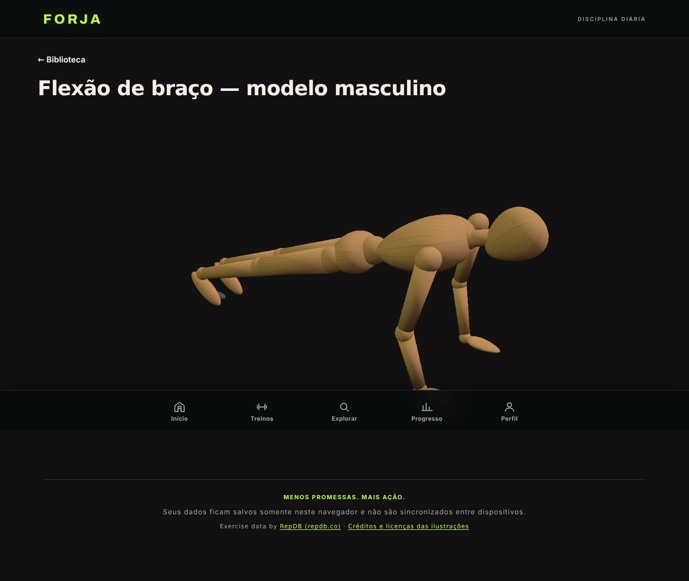
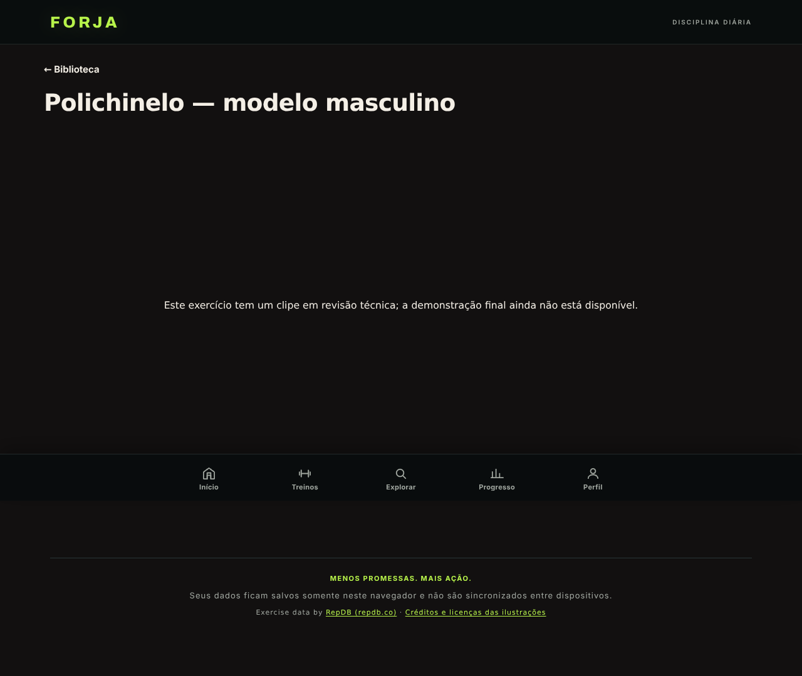

# Apresentação dos exercícios — implementação V2

**Status: pronto para revisão; nenhum vídeo final renderizado.**
Nada foi commitado, enviado, mesclado, publicado ou implantado. Este relatório
pede aprovação antes de qualquer uma dessas ações.

## 1. Resumo executivo

| Item | Resultado |
| --- | --- |
| Exercícios encontrados na biblioteca | **37** (18 calistenia + 19 musculação) |
| Com clipe próprio `status: "exact"` e prévia 3D funcionando | **14** |
| Com apenas clipe `status: "review"` (aproximado) | **15** — tratados como pendentes |
| Sem clipe próprio disponível | **8** — 5 sem catálogo + 3 com clipe já usado por outro exercício |
| Vídeos MP4 finais prontos | **0** |
| Clipes GLB auditados para loop | **43** — 42 fechados + 1 atenção (`caminhada`, 2,1 mm na raiz) |
| Clipes reutilizados entre exercícios | **0** |
| Modelo da prévia web | Manequim de 16 ossos já existente no app |
| Modelo do vídeo final | Originais de 78 ossos/4K do piloto — **render ainda não executado** |
| Páginas, mídias, modelos e animações de V1/piloto alterados | **0** |

A tela final foi implementada e validada no navegador. Ela prioriza o MP4
quando existir um arquivo aprovado; enquanto não existe, mostra a prévia 3D do
clipe **exato** do exercício. Clipe `review` não é exibido como se fosse o
movimento final: a tela informa a pendência. Isso evita reaproveitar o clipe
abdominal ou apresentar outro movimento como se fosse o do exercício.

A regra de **não reutilização** foi aplicada a todos os 37 exercícios: cada
clipe atende no máximo um exercício. Onde o catálogo listava o mesmo clipe em
dois exercícios (`prancha`, `elevacao-pernas`, `caminhada`), o primeiro
exercício ficou com o clipe e o segundo virou pendência explícita. O gerador
falha se essa regra for quebrada.

**Distinção importante:** a prévia web usa o manequim de 16 ossos que já
existe no app, porque os 43 clipes web foram autorados para esse rig. Ela **não
é o vídeo final** e **não** é o modelo realista de 78 ossos/4K do piloto. O
vídeo final, quando renderizado, deve usar os modelos originais e a mesma
preservação de anatomia, roupa, textura e iluminação do piloto. Nenhum MP4 foi
renderizado, então essa preservação ainda não pode ser declarada verificada.

## 2. O que foi implementado

### Tela e player

- `exercicio/index.html` — uma tela com **um título** e **um palco 16:9**. O
  `<video>` nasce com `autoplay`, `muted`, `loop`, `playsinline` e **sem**
  `controls`; não há botão, seletor, barra de progresso, seletor vertical nem
  segundo vídeo.
- `assets/css/exercicio-3d.css` — palco sempre `aspect-ratio: 16 / 9`, fundo
  `#121010`, sem moldura/sombra/gradiente, controles nativos do WebKit/Blink
  desligados por CSS, largura limitada para o palco inteiro caber acima da
  barra inferior em telas baixas. Em retrato continua 16:9; não existe 9:16.
- `assets/js/forja-exercicio-3d.js` — lê o manifesto, monta o título, escolhe
  MP4 aprovado ou prévia 3D, retoma o vídeo sozinho após pausa externa/aba
  oculta, e nunca cria controles. Sem clipe, mostra a pendência com o motivo.
- `assets/js/forja-exercicio-cena.js` — ponte entre o script clássico da página
  e o módulo ESM da cena. Entrega ao `criarCena` somente o modelo e o clipe
  **exatos** que vieram do manifesto; não resolve por grupo muscular.
- `assets/js/forja-3d-cena.js` — modo `modoApresentacao` **aditivo e
  gated**: buffer fixo 1280×720, `pixelRatio 1`, alpha opaco, fundo `#121010`,
  sem piso, câmera azimute −58°/elevação 22°/FOV vertical 32°, enquadramento
  automático sobre a malha deformada em 5 instantes, 30 FPS e loop infinito.
  Sem a flag, o painel interativo existente continua com o comportamento atual
  (os testes de V1 seguem passando).

### Dados e ferramentas

- `tools/gerar-apresentacao-exercicios.mjs` — gera o manifesto a partir da
  biblioteca, do catálogo e dos arquivos reais; só promove um clipe a
  demonstração quando o status é `exact`; garante **um clipe por exercício**
  (falha o build se houver reutilização); mede MP4 (16:9, 1280×720, 30 FPS, sem
  áudio), grava caminhos relativos no manifesto e mantém `--check` para
  detectar manifesto desatualizado em qualquer worktree.
- `tools/lib/loop-3d.mjs` — auditor de emenda de loop por GLB. Critério:
  razão entre o salto da emenda e o maior passo natural da trilha, com pisos
  absolutos de 4°/8° e 4/8 mm. Resultado: **42 fechados, 1 atenção, 0 falhas**.
  A exceção é `caminhada`: 2,1 mm de deslocamento residual na raiz (`hips`),
  registrada e preservada sem correção automática.
- `tools/lib/probe-mp4.mjs` — leitura de metadados MP4 sem ffprobe.
- `assets/3d/apresentacao-exercicios.json` — manifesto publicado (37 entradas,
  especificação, personagens, clipes, pendências, auditoria de loop).
- `assets/videos/exercicios/README.md` — contrato de nome e especificação dos
  MP4 que serão renderizados nessa pasta.

### Publicação e testes

- `tools/preparar-site.sh` — inclui `exercicio/` e os novos assets no artefato
  publicado e valida que nenhum link relativo quebrou.
- `tests/exercicio-apresentacao.test.mjs` — 11 testes do contrato: manifesto,
  clipe abdominal não reutilizado, loop, HTML sem controles, MP4 aprovado,
  prévia 3D exata, pendência sem clipe, `review` não vira demonstração, perfil
  feminino, degradação sem manifesto e gerador atualizado.
- `package.json` — inclui a suíte nova em `npm test` e o atalho
  `npm run test:exercicio`.

## 3. Todos os exercícios encontrados

| ID | Exercício | Modalidade | Clipe | Estado | Pendência / motivo |
| --- | --- | --- | --- | --- | --- |
| `cal-rotacao-ombros` | Rotação de ombros | Calistenia | `rotacao-ombros` | **Prévia 3D** (clipe exact) |  |
| `cal-mobilidade-quadril` | Mobilidade de quadril | Calistenia | `mobilidade-quadril` | **Prévia 3D** (clipe exact) |  |
| `cal-polichinelo` | Polichinelo | Calistenia | `polichinelo` | **Pendente** (clipe review) | Clipe em revisão (referência: Step jack); não é o movimento final. |
| `cal-flexao` | Flexão de braço | Calistenia | `flexao` | **Prévia 3D** (clipe exact) |  |
| `cal-agachamento` | Agachamento livre | Calistenia | `agachamento` | **Prévia 3D** (clipe exact) |  |
| `cal-barra-fixa` | Barra fixa (pegada pronada) | Calistenia | `—` | **Pendente** (sem clipe) | Sem animação própria mapeada. |
| `cal-remada-invertida` | Remada invertida | Calistenia | `remada-invertida` | **Pendente** (clipe review) | Clipe em revisão (referência: Hinged bodyweight row); não é o movimento final. |
| `cal-mergulho` | Paralela (mergulho) | Calistenia | `—` | **Pendente** (sem clipe) | Sem animação própria mapeada. |
| `cal-afundo` | Afundo alternado | Calistenia | `afundo` | **Pendente** (clipe review) | Clipe em revisão (referência: Back step to knee drive); não é o movimento final. |
| `cal-ponte` | Ponte de glúteo | Calistenia | `ponte-gluteo` | **Prévia 3D** (clipe exact) |  |
| `cal-prancha-frontal` | Prancha frontal | Calistenia | `prancha` | **Prévia 3D** (clipe exact) |  |
| `cal-prancha-lateral` | Prancha lateral | Calistenia | `—` | **Pendente** (sem clipe) | Sem animação própria mapeada. |
| `cal-abdominal-supra` | Abdominal supra | Calistenia | `abdominal-supra` | **Prévia 3D** (clipe exact) |  |
| `cal-elevacao-pernas` | Elevação de pernas | Calistenia | `elevacao-pernas` | **Prévia 3D** (clipe exact) |  |
| `cal-abdominal-infra` | Abdominal infra | Calistenia | `abdominal-infra` | **Pendente** (clipe review) | Clipe em revisão (referência: Single leg lowers); não é o movimento final. |
| `cal-burpee` | Burpee | Calistenia | `—` | **Pendente** (sem clipe) | Sem animação própria mapeada. |
| `cal-mountain-climber` | Mountain climber | Calistenia | `mountain-climber` | **Prévia 3D** (clipe exact) |  |
| `cal-corrida-estacionaria` | Corrida estacionária | Calistenia | `corrida-estacionaria` | **Pendente** (clipe review) | Clipe em revisão (referência: Fast feet); não é o movimento final. |
| `mus-esteira` | Esteira em ritmo leve | Musculação | `caminhada` | **Pendente** (clipe review) | Clipe em revisão (referência: March with overhead press); não é o movimento final. |
| `mus-mobilidade-ombro` | Mobilidade de ombro com elástico | Musculação | `circulos-braco` | **Prévia 3D** (clipe exact) |  |
| `mus-supino-reto` | Supino reto com barra | Musculação | `supino` | **Pendente** (clipe review) | Clipe em revisão (referência: Plank to downward dog flow); não é o movimento final. |
| `mus-agachamento-barra` | Agachamento livre com barra | Musculação | `agachamento-halteres` | **Pendente** (clipe review) | Clipe em revisão (referência: Wide mini squat); não é o movimento final. |
| `mus-terra` | Levantamento terra | Musculação | `dobradiça-quadril` | **Pendente** (clipe review) | Clipe em revisão (referência: Hip hinge); não é o movimento final. |
| `mus-puxada-frontal` | Puxada frontal | Musculação | `puxada` | **Pendente** (clipe review) | Clipe em revisão (referência: Knee lift with pull-down); não é o movimento final. |
| `mus-desenvolvimento` | Desenvolvimento com halteres | Musculação | `desenvolvimento` | **Pendente** (clipe review) | Clipe em revisão (referência: Seated shoulder press); não é o movimento final. |
| `mus-remada-curvada` | Remada curvada com barra | Musculação | `remada-sentada` | **Pendente** (clipe review) | Clipe em revisão (referência: Seated rowing); não é o movimento final. |
| `mus-leg-press` | Leg press 45° | Musculação | `—` | **Pendente** (sem clipe) | Sem animação própria mapeada. |
| `mus-rosca-direta` | Rosca direta | Musculação | `rosca-direta` | **Prévia 3D** (clipe exact) |  |
| `mus-triceps-polia` | Tríceps na polia | Musculação | `triceps` | **Prévia 3D** (clipe exact) |  |
| `mus-extensora` | Cadeira extensora | Musculação | `extensao-joelho` | **Pendente** (clipe review) | Clipe em revisão (referência: Seated knee extension); não é o movimento final. |
| `mus-flexora` | Mesa flexora | Musculação | `flexao-joelho` | **Prévia 3D** (clipe exact) |  |
| `mus-elevacao-lateral` | Elevação lateral | Musculação | `elevacao-lateral` | **Prévia 3D** (clipe exact) |  |
| `mus-abdominal-polia` | Abdominal na polia | Musculação | `abdominal-cruzado` | **Pendente** (clipe review) | Clipe em revisão (referência: Standing cross crunch); não é o movimento final. |
| `mus-prancha` | Prancha frontal | Musculação | `—` | **Pendente** (clipe já usado) | O clipe "Prancha frontal" (prancha) já é usado por outro exercício e não é reutilizado aqui. |
| `mus-elevacao-barra` | Elevação de pernas na barra | Musculação | `—` | **Pendente** (clipe já usado) | O clipe "Elevação de pernas" (elevacao-pernas) já é usado por outro exercício e não é reutilizado aqui. |
| `mus-bicicleta` | Bicicleta ergométrica | Musculação | `pedalar` | **Pendente** (clipe review) | Clipe em revisão (referência: Seated pedaling); não é o movimento final. |
| `mus-farmer` | Farmer walk | Musculação | `—` | **Pendente** (clipe já usado) | O clipe "Caminhada" (caminhada) já é usado por outro exercício e não é reutilizado aqui. |

## 3.1 Auditoria das 43 animações

Tabela completa gerada a partir do GLB publicado. `angular máx.` é a maior
costura de rotação; `linear máx.` é a maior costura de translação (em mm); a
classificação usa a razão contra o maior passo natural da trilha e os limites
absolutos de 4°/8° e 4/8 mm. A auditoria é matemática, não visual.

| Arquivo | Status | Duração | Angular máx. | Linear máx. | Observação |
| --- | --- | --- | --- | --- | --- |
| `abdominal-cruzado.glb` | fechado | 3.625 s | 0.5773° | 0.00 mm | — |
| `abdominal-infra.glb` | fechado | 2.625 s | 0.0369° | 0.00 mm | — |
| `abdominal-supra.glb` | fechado | 3 s | 0.1239° | 0.11 mm | — |
| `abre-e-fecha.glb` | fechado | 2.4167 s | 0.1323° | 0.00 mm | — |
| `afundo.glb` | fechado | 1.3333 s | 0.0474° | 0.00 mm | — |
| `agachamento-halteres.glb` | fechado | 2.4167 s | 0.014° | 0.00 mm | — |
| `agachamento.glb` | fechado | 3.2083 s | 0.1193° | 0.16 mm | — |
| `alongamento-1.glb` | fechado | 8.2083 s | 0.0396° | 0.01 mm | — |
| `alongamento-2.glb` | fechado | 4.625 s | 0.0034° | 0.02 mm | — |
| `caminhada.glb` | **atenção** | 1 s | 1.4075° | 2.10 mm | 2,1 mm na raiz (hips); preservado; revisão visual pendente. |
| `circulos-braco.glb` | fechado | 1.7917 s | 0.3179° | 0.00 mm | — |
| `corrida-estacionaria.glb` | fechado | 0.5 s | 2.2629° | 0.00 mm | — |
| `desenvolvimento.glb` | fechado | 2 s | 0.2852° | 0.00 mm | — |
| `dobradiça-quadril.glb` | fechado | 2.8333 s | 0.0183° | 0.00 mm | — |
| `elevacao-lateral.glb` | fechado | 2.625 s | 0.052° | 0.00 mm | — |
| `elevacao-pernas.glb` | fechado | 2.7083 s | 0.0885° | 0.00 mm | — |
| `extensao-joelho.glb` | fechado | 6 s | 0.2552° | 0.00 mm | — |
| `flexao-feminino.glb` | fechado | 6 s | 0.0305° | 0.00 mm | — |
| `flexao-joelho.glb` | fechado | 2.125 s | 0.896° | 0.00 mm | — |
| `flexao.glb` | fechado | 6 s | 0.021° | 0.00 mm | — |
| `mobilidade-quadril.glb` | fechado | 1.8333 s | 0.0428° | 0.00 mm | — |
| `mountain-climber-feminino.glb` | fechado | 4.5 s | 0.0305° | 0.00 mm | — |
| `mountain-climber.glb` | fechado | 4.5 s | 0.021° | 0.00 mm | — |
| `panturrilha.glb` | fechado | 2.625 s | 0.0361° | 0.03 mm | — |
| `peck-deck.glb` | fechado | 3.9167 s | 0.1021° | 0.03 mm | — |
| `pedalar.glb` | fechado | 0.8333 s | 0.037° | 0.00 mm | — |
| `polichinelo.glb` | fechado | 2 s | 3.8481° | 0.00 mm | — |
| `ponte-gluteo.glb` | fechado | 4.125 s | 0.0687° | 0.16 mm | — |
| `pose-biceps.glb` | fechado | 4 s | 0.6932° | 0.00 mm | — |
| `postura-base.glb` | fechado | 3.9167 s | 0.037° | 0.07 mm | — |
| `prancha-feminino.glb` | fechado | 6 s | 0.0327° | 0.00 mm | — |
| `prancha.glb` | fechado | 6 s | 0.0327° | 0.00 mm | — |
| `puxada.glb` | fechado | 2.2083 s | 3.8419° | 0.00 mm | — |
| `remada-alta.glb` | fechado | 2.4167 s | 0.1323° | 0.00 mm | — |
| `remada-invertida.glb` | fechado | 2.4167 s | 0.1312° | 0.05 mm | — |
| `remada-sentada.glb` | fechado | 1.8333 s | 0.0387° | 0.00 mm | — |
| `rosca-direta.glb` | fechado | 2.3333 s | 0.0369° | 0.00 mm | — |
| `rosca-rotacao.glb` | fechado | 2.3333 s | 0.0369° | 0.00 mm | — |
| `rotacao-ombros.glb` | fechado | 2.4167 s | 0.0369° | 1.56 mm | — |
| `salto.glb` | fechado | 3.9167 s | 0.2314° | 0.08 mm | — |
| `step-up.glb` | fechado | 10.4167 s | 0.0411° | 0.06 mm | — |
| `supino.glb` | fechado | 4.2083 s | 1.0539° | 0.50 mm | — |
| `triceps.glb` | fechado | 1.8333 s | 0.0229° | 0.00 mm | — |

**Resumo:** 43 arquivos, **42 fechados**, **1 atenção** (`caminhada`, 2,1 mm
na raiz `hips`), **0 falhas**. Nenhum clipe foi alterado para “corrigir” a
emenda. A validação visual da repetição dos MP4 é etapa posterior.

## 4. Modelos e animações disponíveis

- **Modelos da prévia web**: `assets/3d/personagens/masculino.glb` (880.944 B)
  e `feminino.glb` (893.252 B), rig de 16 ossos. Nenhum modelo foi criado,
  substituído, reescalado ou retexturizado nesta etapa.
- **Modelos do vídeo final**: os originais do piloto (masculino
  20.465.552 B, SHA-256 `ad3ac1c9…80d1`; feminino 20.650.336 B, SHA-256
  `7f294533…6077`), com 78 ossos e 3 texturas 4K. O roteiro
  `tools/blender/piloto-abdominal-cycles.py` já contém o mapeamento do clipe de
  16 ossos para esse rig. Nenhum byte desses modelos foi alterado. Eles não
  foram baixados nem usados nesta etapa porque a renderização não foi
  autorizada.
- **Clipes**: 43 arquivos GLB em `assets/3d/animacoes/`, 24 FPS no arquivo,
  loop marcado no catálogo. O catálogo tem 40 clipes (20 `exact` + 20 `review`)
  e há 3 variantes por personagem (`flexao-feminino`, `mountain-climber-feminino`,
  `prancha-feminino`), totalizando 43 arquivos auditados.
- **Clipes `exact` usados nas 14 prévias**: rotação de ombros, mobilidade de
  quadril, flexão, agachamento, ponte de glúteo, prancha, abdominal supra,
  elevação de pernas, mountain climber, círculos de braço, rosca direta,
  tríceps, flexão de joelho e elevação lateral. O clipe abdominal
  (`abdominal-supra`) atende **somente** `cal-abdominal-supra`.
- **Conflitos de reuso (3)**: `prancha` já usada por `cal-prancha-frontal`
  (então `mus-prancha` fica pendente); `elevacao-pernas` já usada por
  `cal-elevacao-pernas` (então `mus-elevacao-barra` fica pendente);
  `caminhada` já usada por `mus-esteira` (então `mus-farmer` fica pendente).
  Nenhum desses três recebeu o clipe do outro.
- **Exceção de loop**: `caminhada` tem 2,1 mm de deslocamento residual na raiz
  (`hips`) entre o último e o primeiro quadro. O clipe **não foi corrigido**;
  ele continua com `status: "review"` e a exceção está registrada no manifesto
  e na auditoria.
- **11 clipes do catálogo não têm exercício na biblioteca** (postura-base,
  abre-e-fecha, rosca-rotacao, panturrilha, remada-alta, peck-deck, step-up,
  salto, alongamento-1, alongamento-2, pose-biceps). Eles não são usados para
  preencher exercício nenhum.

## 5. Confirmações de especificação

| Requisito | Situação | Evidência |
| --- | --- | --- |
| Horizontal 16:9 | **Confirmado na tela** | `aspect-ratio: 16 / 9`; medição real no Chromium: 1140×641 e 370×208,125 → razão 1,7778 |
| 1280 × 720 | **Confirmado no palco** | Canvas com buffer `[1280, 720]`; gerador só aceita MP4 1280×720 (e rejeita outras resoluções) |
| 30 FPS | **Implementado no palco; não medido empiricamente** | Laço fixo em `1/30 s` e metadados do manifesto em 30 FPS. Não há contador de quadros no teste nem MP4 final para medir a taxa efetiva |
| Fundo `#121010` uniforme | **Confirmado na tela** | CSS + clear color + fundo da cena; captura decodificada no palco: RGB (18, 16, 16) = `#121010`; sem piso, aro, gradiente ou moldura |
| Câmera ¾ quase lateral | **Confirmado na tela** | Azimute −58°, elevação 22°, FOV vertical 32°, iguais ao piloto; dataset da página e `api.especificacao` |
| Corpo inteiro visível | **Confirmado na tela** | Enquadramento automático pela silhueta deformada em 5 instantes; conferido em flexão, agachamento, abdominal, prancha e mountain climber |
| Autoplay | **Confirmado no player** | Teste real com MP4 1280×720/30 sem áudio: `paused: false` após carregar |
| Loop infinito | **Confirmado no player; auditoria matemática parcial** | `loop=true`; após 6,5 s o `currentTime` voltou de ~6,0 s para ~2,3 s. 42/43 clipes fechados; `caminhada` tem 2,1 mm de raiz e está registrada como atenção. Isso **não** prova continuidade visual no MP4 |
| Mudo | **Confirmado no player** | `muted=true`, `defaultMuted=true`; gerador rejeita MP4 com trilha de áudio |
| Inline | **Confirmado no player** | `playsinline` + `webkit-playsinline` |
| Sem controles/pausa/reinício/barra | **Confirmado no player** | `controls=false`, atributo `controls` ausente, 0 `<button>/<select>/<input>/<progress>`, clique no palco não pausa; CSS desliga a barra nativa |
| Sem seletor vertical/9:16 | **Confirmado** | Nenhuma ocorrência de 9:16 no HTML/CSS; um único `<video>` e um único palco |
| Tela só com título + demonstração | **Confirmado** | Um `<h1>`, um palco; sem cartões, abas, mosaicos, poster ou controles. O palco contém vídeo, prévia 3D ou a mensagem de pendência. Cabeçalho, link “← Biblioteca”, rodapé e barra inferior são o shell padrão do app |
| Modelos preservados | **Parcial — só a prévia** | Nenhum GLB de personagem foi modificado; a prévia usa o manequim 16 ossos do app. O vídeo final com os modelos 78 ossos/4K **não foi renderizado**, então a preservação visual do modelo realista ainda não foi verificada |
| Animação própria por exercício | **Parcial, por decisão conservadora** | 14 exercícios têm prévia própria; 15 `review` e 8 sem clipe ficaram pendentes. Nenhum movimento foi inventado ou reutilizado |
| Não reutilização de movimento | **Confirmado no manifesto e nos testes** | 0 clipes repetidos; 3 conflitos viraram pendência; teste 2b e trava do gerador |

### A auditoria matemática não substitui a inspeção visual

A auditoria de loop acima compara amostras do GLB. Ela é útil para detectar
saltos grosseiros e está registrada por clipe, mas **não** prova que o vídeo
renderizado, depois de quantização, interpolação, motion blur e codificação,
tenha uma emenda visualmente contínua. Essa validação será feita quadro a quadro
nos MP4 renderizados, comparando o último e o primeiro quadro e inspecionando a
repetição. Até lá, o loop está **implementado e auditado matematicamente**, não
**visualmente validado**.

### Evidência visual da tela (prévia, não vídeo final)

*`cal-flexao`, viewport 1280×800 e captura full page 1280×1080, Chromium real:
palco 16:9, fundo `#121010`, câmera ¾, corpo inteiro e nenhum controle. A
figura é o manequim de 16 ossos da prévia; o vídeo final, ainda não
renderizado, usará o modelo realista de 78 ossos/4K.*

*`cal-polichinelo`: clipe `review` (step jack) não é exibido como se fosse o
movimento final; a tela mostra a pendência.*

### O que ainda não pode ser confirmado

- **Vídeo MP4 final**: não existe nenhum arquivo em `assets/videos/exercicios/`.
  Portanto, cor do fundo **depois da codificação/decodificação**, FPS do arquivo
  final, duração, emenda visual do MP4 e hash SHA-256 só podem ser verificados
  depois da renderização autorizada.
- **Preservação do modelo realista no vídeo**: a prévia web usa o manequim de
  16 ossos. O vídeo final precisa ser renderizado com os modelos originais de
  78 ossos/4K e com o mapeamento do piloto; só a renderização e a inspeção
  quadro a quadro podem confirmar anatomia, roupa, cores, materiais e texturas.
- **Emenda visual do vídeo**: a auditoria acima é do GLB. Ela classifica 42
  clipes como fechados e registra a exceção de 2,1 mm da `caminhada`; não
  substitui a inspeção quadro a quadro do MP4 renderizado.
- **Link de entrada na interface**: a tela está acessível por URL direta. Não
  alterei Biblioteca/Execução (V1) para adicionar um botão, justamente para
  respeitar a restrição de não editar V1. Posso adicionar um link mínimo depois
  da aprovação.

## 6. Pendentes (23 exercícios)

### 6.1 Clipe `review` — não é o movimento final (15)

| Exercício | Clipe em revisão | Referência do clipe | Motivo |
| --- | --- | --- | --- |
| `cal-polichinelo` | `polichinelo` | Step jack | Não é jumping jack; falta animação própria |
| `cal-remada-invertida` | `remada-invertida` | Hinged bodyweight row | Movimento aproximado; revisão técnica pendente |
| `cal-afundo` | `afundo` | Back step to knee drive | Movimento aproximado; revisão técnica pendente |
| `cal-abdominal-infra` | `abdominal-infra` | Single leg lowers | Movimento aproximado; revisão técnica pendente |
| `cal-corrida-estacionaria` | `corrida-estacionaria` | Fast feet | Movimento aproximado; revisão técnica pendente |
| `mus-esteira` | `caminhada` | March with overhead press | Marcha com elevação de braços, não esteira |
| `mus-supino-reto` | `supino` | Plank to downward dog flow | Não é supino com barra |
| `mus-agachamento-barra` | `agachamento-halteres` | Wide mini squat | Miniaagachamento, não agachamento com barra |
| `mus-terra` | `dobradiça-quadril` | Hip hinge | Dobradiça sem barra, não levantamento terra |
| `mus-puxada-frontal` | `puxada` | Knee lift with pull-down | Movimento diferente |
| `mus-desenvolvimento` | `desenvolvimento` | Seated shoulder press | Sentado, não em pé |
| `mus-remada-curvada` | `remada-sentada` | Seated rowing | Remada sentada, não curvada |
| `mus-extensora` | `extensao-joelho` | Seated knee extension | Aproximado; revisão técnica pendente |
| `mus-abdominal-polia` | `abdominal-cruzado` | Standing cross crunch | Em pé, não na polia |
| `mus-bicicleta` | `pedalar` | Seated pedaling | Pedalada sentada, não bicicleta no ar |

### 6.2 Clipe já usado por outro exercício (3)

| Exercício | Clipe existente | Já usado por | Decisão |
| --- | --- | --- | --- |
| `mus-prancha` | `prancha` | `cal-prancha-frontal` | Pendente; não reutiliza a prancha da calistenia |
| `mus-elevacao-barra` | `elevacao-pernas` | `cal-elevacao-pernas` | Pendente; elevação de pernas deitada não é barra fixa |
| `mus-farmer` | `caminhada` | `mus-esteira` | Pendente; marcha com braços acima da cabeça não é farmer carry |

### 6.3 Sem clipe próprio (5)

`cal-barra-fixa` (barra fixa), `cal-mergulho` (paralela), `cal-prancha-lateral`
(prancha lateral), `cal-burpee` (burpee) e `mus-leg-press` (leg press 45°).
Nenhum tem clipe mapeado no catálogo; não foram inventados movimentos nem
emprestados clipes de outro exercício.

## 7. Arquivos

### Criados

| Arquivo | Função |
| --- | --- |
| `exercicio/index.html` | Tela título + palco 16:9 |
| `assets/css/exercicio-3d.css` | Estilo escopado, sem moldura/controles |
| `assets/js/forja-exercicio-3d.js` | Controlador da tela e do player |
| `assets/js/forja-exercicio-cena.js` | Ponte clássico → ESM, modo apresentação |
| `assets/3d/apresentacao-exercicios.json` | Manifesto das 37 entradas |
| `tools/gerar-apresentacao-exercicios.mjs` | Gerador/verificador do manifesto |
| `tools/lib/loop-3d.mjs` | Auditor de loop dos GLB |
| `tools/lib/probe-mp4.mjs` | Leitor de metadados MP4 |
| `assets/videos/exercicios/README.md` | Contrato de nome/formato dos MP4 |
| `tests/exercicio-apresentacao.test.mjs` | 11 testes do contrato |
| `docs/validacao-3d/fase2/relatorio-apresentacao-exercicios.md` | Este relatório |
| `docs/validacao-3d/fase2/apresentacao-cal-flexao.png` | Evidência visual da prévia 3D |
| `docs/validacao-3d/fase2/apresentacao-polichinelo-pendente.png` | Evidência visual da pendência por revisão |

### Modificados (aditivos)

| Arquivo | Mudança | Impacto em V1 |
| --- | --- | --- |
| `assets/js/forja-3d-cena.js` | Modo `modoApresentacao` gated + enquadramento automático | Nenhum quando a flag não é passada; testes de V1 passam |
| `tools/preparar-site.sh` | Inclui a página e os assets novos no artefato | Nenhum no app existente |
| `package.json` | Inclui a suíte nova em `npm test` | Nenhum no app |

`assets/js/forja-core.js` e `assets/js/forja-personagens.js` foram inicialmente
tocados e **restaurados ao estado original**; não há diff neles. Nenhuma página
da V1, nenhum vídeo/poster do piloto, nenhum modelo e nenhuma animação foram
alterados.

## 8. Verificações executadas

1. `node tools/gerar-apresentacao-exercicios.mjs --check` → manifesto atualizado.
2. `npm test` → código de saída **0** (suítes existentes + nova).
3. `node tests/exercicio-apresentacao.test.mjs` → **13/13**.
4. `node tests/personagens3d.test.mjs` → **18/18**.
5. `node tests/mapeamento3d.test.mjs` → **9/9**.
6. `bash tools/preparar-site.sh /tmp/forja-site` → **324 arquivos**, links
   relativos **OK**, 148 imagens WebP.
7. Chromium real (SwiftShader) em 1280×800 e 390×844:
   - canvas `1280×720`; palco 16:9 exato;
   - fundo do palco `#121010` (18, 16, 16);
   - 0 botões/select/input/progress; `controls=false`; sem overflow horizontal;
   - prévia 3D montada para `cal-flexao`, `cal-prancha-frontal` e
     `cal-elevacao-pernas`; as três com canvas 1280×720 e palco 16:9;
   - `cal-polichinelo` e `mus-terra` → pendência de revisão;
   - `cal-barra-fixa` → pendência sem clipe;
   - `mus-prancha`, `mus-elevacao-barra` e `mus-farmer` → pendência de reuso
     (clipe já usado por outro exercício), sem montar a cena;
   - `mus-esteira` → pendência de revisão.
8. Player com MP4 de teste 1280×720/30 sem áudio (cópia temporária do piloto,
   fora do repositório): autoplay, loop, mudo, inline, sem controles; após
   6,5 s o tempo voltou de ~6,0 s para ~2,3 s; clique não pausou.

## 9. O que não foi feito

- Nenhum MP4 foi renderizado, nem com o modelo realista de 78 ossos/4K.
- Nenhum commit, push, merge, deploy ou publicação.
- Nenhuma alteração em `main`, na V1 ou no piloto aprovado.
- Nenhum modelo/animacão foi criado, substituído ou “corrigido”.

## 10. Decisões que preciso de você

1. **Aprovar a implementação** (tela, player, manifesto, auditoria e testes).
2. **Autorizar a renderização** dos 14 exercícios com prévia própria primeiro,
   usando os modelos originais de 78 ossos/4K e o mapeamento do piloto? Ou
   esperar a autoração dos 23 pendentes para renderizar os 37 de uma vez?
   Os 3 exercícios sem clipe próprio por regra de não reutilização
   (`mus-prancha`, `mus-elevacao-barra`, `mus-farmer`) dependem de animação
   própria; não serão preenchidos com o clipe do vizinho.
3. **Clipes `review`**: manter como pendência (recomendado, é o que está
   implementado) ou permitir exibi-los como “prévia aproximada” enquanto a
   animação própria não existe?
4. **Link de entrada**: adicionar um link mínimo na Biblioteca/Execução (V1)
   para abrir a tela, ou manter somente URL direta por enquanto?
5. **Arquivo compartilhado**: aceitar a extensão gated em
   `assets/js/forja-3d-cena.js` ou extrair o modo apresentação para um módulo
   separado antes da renderização?
6. **Fallback 3D**: manter o manequim de 16 ossos como prévia técnica enquanto
   o MP4 realista não existe, ou exibir somente a pendência até o vídeo final?
   A segunda opção remove a prévia, mas deixa a tela sem demonstração nenhuma.

Depois da aprovação, o próximo passo é renderizar, verificar quadro a quadro
(fundo decodificado, 1280×720, 30 FPS, emenda visual) e só então apresentar os
MP4 para nova aprovação. Não vou commitar, enviar, mesclar nem publicar sem
essa autorização explícita.
