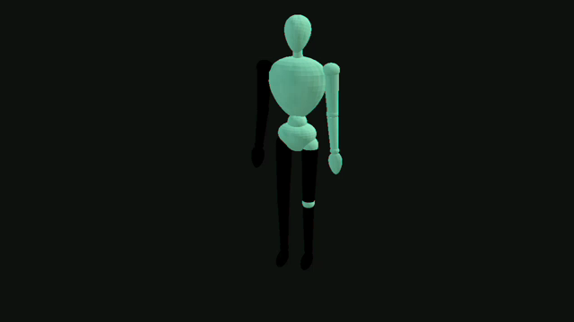
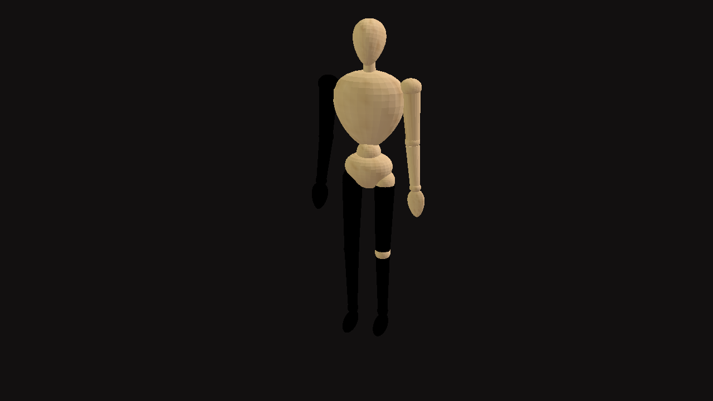

# Recuperação, reconstrução e verificação dos 28 MP4 — laudo com evidências

**Sessão:** `arena/4cf65613-forja` · **Base reconstruída:** `41a00c8` (mesmo commit de `origin/main`) · **Data:** 2026-11-03 (UTC)
**Status:** verificações técnicas **concluídas e aprovadas**; **1 achado visual bloqueante** para aceite dos vídeos e **1 falha pré-existente** no e2e opcional. Nada foi mesclado, publicado, re-renderizado ou descartado.

---

## 1. Diagnóstico antes de qualquer alteração

### 1.1 A branch `arena/07e4fcdb-forja` não existe

| Verificação | Comando | Resultado |
| --- | --- | --- |
| Refs remotas | `git ls-remote --heads origin` | **53** branches listadas; **nenhuma** `07e4fcdb` |
| Ref exata | `git ls-remote origin refs/heads/arena/07e4fcdb-forja` | vazio |
| API GitHub | `GET repos/1Rayke1/forja/branches/arena/07e4fcdb-forja` | **404 — Branch not found** |
| PRs (51, todos os estados) | `gh pr list --state all --limit 200` | nenhum PR com head `07e4fcdb` ou `4cf65613` |
| Busca de código / eventos | `search/code`, `repos/.../events` | `total_count: 0`; nenhum evento de criação da ref |
| Objetos locais | `git reflog --all`, `git fsck --unreachable` | apenas o clone raso; nenhum objeto pendente |

**Conclusão:** o nome `arena/07e4fcdb-forja` não corresponde a nenhuma ref publicada. Não foi inventada, criada nem simulada.

### 1.2 O conteúdo da entrega está integralmente preservado

O trabalho que a branch representaria **existe e está mesclado em `main`**:

| Entrega | Onde está preservada | Evidência |
| --- | --- | --- |
| 28 MP4 (14 exercícios × 2 personagens) | `assets/videos/exercicios/` em `origin/main` | PR #51, mesclado em 2026-11-02 17:46:53Z |
| Manifesto `assets/3d/apresentacao-exercicios.json` | `origin/main` | PR #51 (493 adições / 45 remoções) |
| `tools/renderizar-videos-3d.mjs`, `tools/renderizar-todos-os-videos.mjs` | `origin/main` | PR #51 (671 + 91 linhas novas) |
| `tests/exercicio-apresentacao.test.mjs` atualizado | `origin/main` | PR #51 |
| Infraestrutura, `forja-exercicio-3d.js`, `gerar-apresentacao-exercicios.mjs`, `lib/probe-mp4.mjs`, `lib/loop-3d.mjs` | `origin/main` | PR #50 (`arena/0bd69e1c-forja`), mesclado em 15:53:44Z |

A cabeça do PR #51, `arena/93e7ac6f-forja`, existe no remoto e está `ahead_by: 0, behind_by: 1` em relação a `main` — ou seja, **todo o conteúdo dela já está em `main`**. A comparação `0f24e7d...41a00c8` pela API retornou `ahead_by: 4, behind_by: 0, files_total: 34`.

### 1.3 Confirmações pedidas

| Item | Resultado |
| --- | --- |
| Branch com todas as modificações | ❌ nome inexistente; ✅ **conteúdo** preservado em `main` / `arena/93e7ac6f-forja` |
| 28 MP4 + manifesto | ✅ **28 arquivos**, 7.276.163 bytes, manifesto de 104.306 bytes com `comVideoPronto: 14` |
| Testes e scripts adicionados | ✅ **13** arquivos `tests/*.test.mjs` e **5** ferramentas de render/probe/geração presentes |

### 1.4 Reconstrução sem descartar nada

O checkout original era raso, no commit `0f24e7d` (merge do PR #49), **4 commits atrás** de `main`. Foi feito um avanço rápido na própria branch da sessão:

```
git reset --hard origin/main      # 0f24e7d → 41a00c8, sem merge commit
```

- `git diff --name-status HEAD origin/main` → **0 arquivos removidos** (apenas 34 adições/modificações).
- `git status` estava limpo antes da operação; nenhum arquivo não commitado foi perdido.
- Não houve troca de branch, criação de branch, push para outra branch, merge ou publicação.

---

## 2. Ambiente reconstruído

| Item | Valor |
| --- | --- |
| Node / npm | v22.22.3 / 10.9.8 |
| Instalação | `npm ci --no-audit --no-fund` → **122 pacotes, exit 0** |
| Dependências relevantes | `@ffmpeg/core@0.12.0`, `jpeg-js@0.4.4`, `three@0.180.0`, `jsdom@30.1.3`, `puppeteer-core@24.43.1`, `@sparticuz/chromium@138.0.2` |
| ffmpeg/ffprobe do sistema | ausentes — toda a decodificação foi feita com **ffmpeg.wasm**, a mesma dependência do pipeline |

---

## 3. Verificações executadas (saídas reais nos logs)

| # | Comando | Resultado | Log |
| --- | --- | --- | --- |
| 1 | `npm ci` | exit 0 | `logs/01-npm-ci.txt` |
| 2 | `npm test` (12 suítes) | **exit 0**, 352 linhas, todos verdes | `logs/02-npm-test.txt` |
| 3 | `node tools/gerar-apresentacao-exercicios.mjs --check` | **exit 0** — "Manifesto atualizado: 37 exercícios" | `logs/03-manifest-check.txt` |
| 4 | `node tools/verificar-videos-exercicios.mjs --reproduzir --quadros` | **28/28 conformes, 0 problemas técnicos** | `logs/04-verificar-videos.txt`, `evidencias.json` |
| 5 | `node tools/diagnosticar-cor-videos.mjs` | **exit 0** — cadeia causal confirmada | `logs/05-diagnostico-cor.txt`, `diagnostico-cor.json` |
| 6 | Inventário/estado do Git | 28 MP4, 13 testes, 5 ferramentas, 0 exclusões | `logs/06-estado-e-inventario.txt` |
| 7 | `node tests/avaliacao-piloto-3d.test.mjs` (fora do `npm test`) | **exit 0** | `logs/07-teste-piloto-3d.txt` |
| 8 | `npm run test:e2e` (Chromium real) | **35/36**, 1 falha pré-existente (§5.2) | `logs/08-e2e.txt` |

### 3.1 Resultado técnico por vídeo (28 arquivos)

Todos os 28 passaram em **todas** as checagens abaixo. Os valores por arquivo estão em `evidencias.json`.

| Verificação | Resultado |
| --- | --- |
| Inventário | 28 MP4 no disco, 28 referências no manifesto, **0 órfãos** |
| Manifesto | `status: "pronto"` e **0 divergências** entre os 9 metadados gravados e a medição atual |
| Resolução / proporção | 1280 × 720, 1,7778 (16:9) em 28/28 |
| FPS (metadado e empírico) | 30 em 28/28; contagem de quadros decodificados `/ duração` = **30,000–30,001** |
| Codec / formato de pixel | `avc1`, `chromaFormatIdc: 1` (**yuv420p**) lido do SPS da caixa `avcC` em 28/28 |
| Áudio | nenhuma trilha `soun` em 28/28 |
| `+faststart` | `moov` antes de `mdat` em 28/28 |
| Fundo | RGB(13, 17, 13) medido nos 4 cantos do primeiro quadro em **todos** os vídeos; compatível com `#121010` após o round-trip YUV 4:2:0 (tolerância ±8) |
| Integridade | SHA-256 = blob do Git (`git hash-object` = `git ls-tree HEAD`) em 28/28 |
| Decodificação | ffmpeg.wasm decodificou **todos**; 54 a 180 quadros por arquivo (média 95,43) |
| Emenda do loop | diferença média 1º↔último = **4,02** (0,138–16,501) contra 1º↔meio = 3,98 e 1º↔2º = 0,03; numericamente coerente com um ciclo fechado |
| Reprodutibilidade | 1 vídeo re-renderizado com o pipeline commitado → **byte a byte idêntico**: SHA-256 `4de55795…699`, 342.711 bytes |

---

## 4. Achado visual bloqueante: a cor do personagem está invertida

**Não corrigido nesta sessão.** Requer decisão de revisão humana antes de aceitar os 28 MP4.

### 4.1 O que foi medido

| Amostra | Cor média dos pixels claros (RGB) |
| --- | --- |
| Textura oficial de madeira embutida em `masculino.glb` | **(167,2 / 123,8 / 78,3)** — bege |
| Quadro salvo pelo próprio rasterizador, antes do encoder (`quadros/rasterizador-antes-do-encoder.png`) | **(169,6 / 142,6 / 101,1)** — bege |
| Primeiro quadro **decodificado do MP4 publicado** (`quadros/primeiro-quadro-masculino.png`) | **(98,0 / 167,5 / 139,4)** — verde-azulado |

Os **28** vídeos apresentam distância RGB de **102,1 a 171,2** (média 132,7) até a textura oficial, acima do limite de 60 usado como indicador. Comparação visual:

| Publicado (verde-azulado) | Referência do rasterizador (bege) |
| --- | --- |
|  |  |

Também foi salvo `quadros/primeiro-quadro-feminino.png`. A referência oficial de perfil está em `../../fase2/personagem-masculino-perfil.png`.

### 4.2 Causa raiz confirmada por experimento reproduzível

`tools/diagnosticar-cor-videos.mjs` reconstrói o caminho quadro → BMP → H.264 → decode:

| Caminho | Cor média resultante | Distância até o MP4 publicado |
| --- | --- | --- |
| rasterizador (referência) | 169,6 / 142,6 / 101,1 | 84,9 |
| **BMP corrigido** → MP4 | 166,0 / 141,7 / 98,4 | 84,9 |
| **BMP como escrito hoje** → MP4 | **98,0 / 167,5 / 139,4** | **0,0** |
| MP4 publicado | 98,0 / 167,5 / 139,4 | — |

O escritor `bmpDeFrame()` em `tools/renderizar-videos-3d.mjs` usa `while (o % 4 !== 0) saida[o++] = 0;` com `o` iniciando em **54** (cabeçalho BMP, não múltiplo de 4). Na primeira linha isso incrementa `o` em 2 sem escrever nada (o buffer já foi dimensionado sem padding), deslocando **todas as linhas seguintes em 2 bytes**. Como 2 não é múltiplo de 3, os canais BGR giram. Confirmações no experimento:

- primeira diferença entre o writer atual e o corrigido no **offset 3894**, exatamente o fim da linha 0 (`54 + 1280×3`);
- **linha 0 idêntica** nos dois writers;
- o MP4 publicado casa **exatamente** (distância 0) com o writer defeituoso.

O diagnóstico está em `diagnostico-cor.json`. A correção seria alinhar o padding ao início de cada linha (ou escrever cada linha em `54 + y × passoLinha`). **Não foi aplicada**: corrigir implicaria re-renderizar os 28 MP4, o que esta sessão foi instruída a não refazer.

---

## 5. Outros pontos para revisão

### 5.1 Emenda do loop — 2 casos com folga maior

`cal-abdominal-supra` (feminino 16,501 / masculino 12,988) e `cal-ponte` (feminino 15,336 / masculino 11,360) têm a maior diferença entre o primeiro e o último quadro. Em todos os casos a diferença 1º↔último é da mesma ordem da diferença 1º↔meio, mas estes merecem inspeção visual quadro a quadro, que estava listada como pendente em `docs/validacao-3d/fase2/relatorio-apresentacao-exercicios.md`.

### 5.2 Falha pré-existente no e2e opcional (não relacionada aos vídeos)

`npm run test:e2e`: **35/36**. Falha: `Explorar — busca e resultados inline…` → *"Catálogo inline ausente"*. O teste procura `#catalog-root` em `explorar/`, mas esse elemento hoje só existe em `treino/biblioteca.html` (a tela Explorar foi reformulada no PR #43). É um descompasso entre teste e UI, anterior a esta sessão; **não foi alterado**. A suíte oficial `npm test` passa integralmente.

---

## 6. O que **não** foi feito

- ❌ Nenhum merge de PR, nenhum deploy/publicação do site e nenhuma release. O PR aberto a partir desta branch existe **apenas para revisão**.
- ❌ Nenhuma re-renderização dos 28 MP4 entregues (apenas 1 render de calibração em `/tmp`, descartado, para provar determinismo).
- ❌ Nenhuma correção no rasterizador, no manifesto ou nos vídeos.
- ❌ Nenhum arquivo descartado, movido ou renomeado; nenhuma troca ou criação de branch; nenhum push para outra branch.
- ❌ Nenhuma evidência fabricada: todos os números vêm de execuções registradas em `logs/`.

---

## 7. Como reproduzir

```bash
npm ci
npm test
node tools/gerar-apresentacao-exercicios.mjs --check
node tools/verificar-videos-exercicios.mjs --reproduzir --quadros
node tools/diagnosticar-cor-videos.mjs
node tests/avaliacao-piloto-3d.test.mjs
```

## 8. Índice de evidências

```
docs/validacao-3d/verificacao-28-videos/
├── RELATORIO.md                              (este laudo)
├── evidencias.json                           (28 registros, medições e hashes)
├── diagnostico-cor.json                      (experimento da causa raiz)
├── logs/01-npm-ci.txt
├── logs/02-npm-test.txt
├── logs/03-manifest-check.txt
├── logs/04-verificar-videos.txt
├── logs/05-diagnostico-cor.txt
├── logs/06-estado-e-inventario.txt
├── logs/07-teste-piloto-3d.txt
├── logs/08-e2e.txt
└── quadros/
    ├── primeiro-quadro-masculino.png
    ├── primeiro-quadro-feminino.png
    └── rasterizador-antes-do-encoder.png
```

Ferramentas novas (somente leitura sobre os MP4s): `tools/verificar-videos-exercicios.mjs` e `tools/diagnosticar-cor-videos.mjs`.
